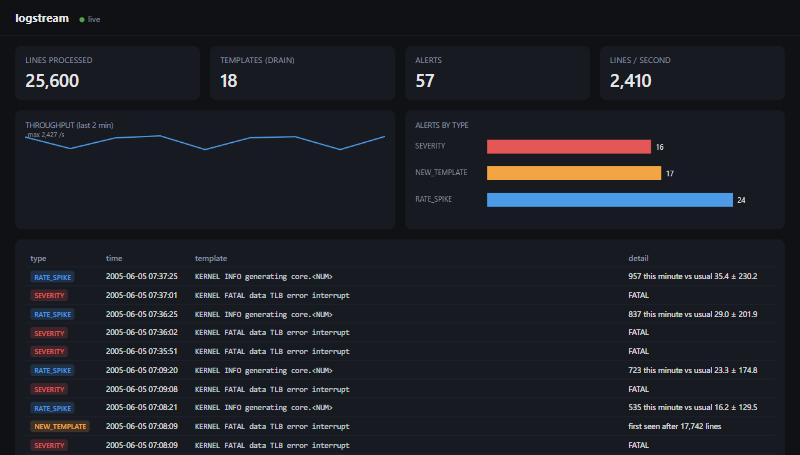
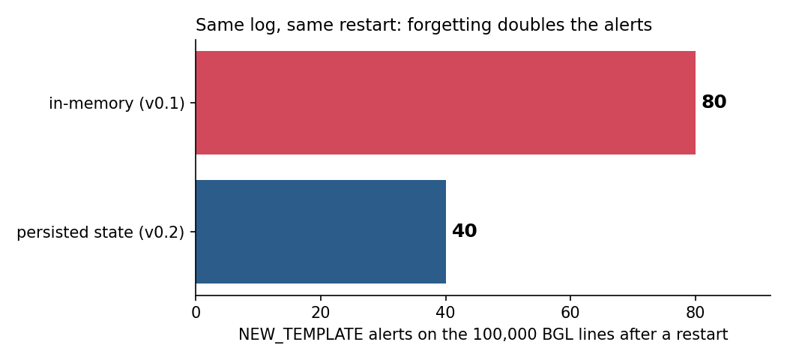

# logstream

**A small real-time log anomaly detection service.** Send raw log lines over HTTP and get alerts back immediately, with a live dashboard. It turns the findings of my offline study [log-anomaly-bench](https://github.com/Zolnarb1/log-anomaly-bench) into something you could actually deploy.


*Replaying the BlueGene/L supercomputer log into the service. Alerts arrive as lines stream in.*

## What it detects
| Alert | Rule | Why (from the offline study) |
|---|---|---|
| `SEVERITY` | line carries `FATAL` / `CRITICAL` / `FAILURE`; at most one alert per template per minute | on BGL this single signal reached F1 0.80, better than any ML model I tested |
| `NEW_TEMPLATE` | Drain creates a template never seen before (after a warm-up) | 67% of anomalies in the test period came from templates unseen in training (concept drift) |
| `RATE_SPIKE` | a template's count this minute > mean + 4σ of its past minutes (min. 20) | catches floods of "normal-looking" messages |

Templates are mined online with [Drain3](https://github.com/logpai/Drain3). Numbers and hex values are masked, so `generating core.2275` and `generating core.862` become one template.

## API
| Method | Path | |
|---|---|---|
| `POST` | `/ingest` | `{"lines": ["raw line", ...], "timestamp": 1117838570}` → alerts raised by this batch |
| `GET` | `/alerts?limit=50&kind=SEVERITY` | recent alerts, newest first |
| `GET` | `/templates?top=20` | most frequent templates |
| `GET` | `/stats` | counters for the dashboard |
| `POST` | `/snapshot` | save the detector state now (when persistence is on) |
| `GET` | `/health` | liveness probe |
| `GET` | `/` | live dashboard (vanilla JS, polls every second) |

Interactive docs are at `/docs` (FastAPI / OpenAPI).

```bash
curl -X POST localhost:8000/ingest -H "Content-Type: application/json" \
     -d '{"lines": ["KERNEL FATAL data TLB error interrupt"]}'
```

## Run it
```bash
# local
python -m venv .venv && .venv\Scripts\activate
pip install -r requirements.txt && pip install -e .
uvicorn logstream.api:app --port 8000
python scripts/replay.py --speed 10        # in a 2nd terminal: stream a real log in
                                           # then open http://localhost:8000

# docker (state kept in a named volume, survives restarts and upgrades)
docker build -t logstream .
docker run -p 8000:8000 -v logstream-data:/data logstream
```
Configuration via environment variables:

| Variable | Default | |
|---|---|---|
| `LOGSTREAM_WARMUP` | 500 | lines before new-template alerts start |
| `LOGSTREAM_SPIKE_K` | 4 | σ multiplier for rate spikes |
| `LOGSTREAM_STATE` | unset locally, `/data/state.json` in Docker | where to persist state; unset = in-memory only |
| `LOGSTREAM_SAVE_EVERY` | 30 | max seconds between automatic saves while ingesting |

## Persistence
Without it, a restart forgets every learned template: message types the service already knew get reported as "new" again, and rate statistics start from zero.


*`scripts/restart_effect.py`: 200k BGL lines, restart at the halfway point. The in-memory detector raises 80 `NEW_TEMPLATE` alerts on the second half; the restored one raises 40, only for templates it had never seen.*

- **What is saved:** the Drain template tree, per-template rate statistics (Welford mean/variance), counters and recent alerts. The per-minute dedup sets are not saved, since they only matter within the current minute.
- **When:** at startup the state is restored; while ingesting it is saved at most every `LOGSTREAM_SAVE_EVERY` seconds; on graceful shutdown (SIGTERM, `docker stop`) it is saved once more. `POST /snapshot` forces a save.
- **Safety:** writes are atomic (temp file + rename), so a crash mid-save never leaves a half-written file. A corrupt state file is moved aside to `state.json.corrupt` and the service starts fresh instead of crash-looping.
- **Cost, measured** (`scripts/bench_state.py`, 200k BGL lines, 90 templates): 154 KiB state file, 7 ms to save, 6 ms to restore, restored stats identical.
- **Tested:** round-trip equality, no false `NEW_TEMPLATE` after restart, rate spikes still detected after restart, save on shutdown, corrupt-file handling. CI also restarts the real container on a volume and checks the state came back.
- **Caveat:** the template tree is encoded with jsonpickle (Drain3's own snapshot format), which can instantiate Python objects, so only load state files this service wrote.

## Engineering notes
- **Throughput:** the detector handles ~150k lines/s on one laptop thread (`scripts/bench.py`, 200k BGL lines, detection logic only, without HTTP).
- **Deterministic and testable:** time is passed into the detector instead of read from the clock. Rate statistics use Welford's online mean/variance (O(1) memory per template).
- **Thread safety:** Drain3 isn't thread-safe, so a lock wraps detector access in the API.
- **Bounded memory:** the alert buffer is capped (500), as is the per-minute dedup set.
- **Input validation:** Pydantic models reject malformed payloads with 422 and cap batch size (10,000 lines).
- **Tests** (`tests/`, 13): each alert type, warm-up, per-minute dedup, rate-spike dedup, endpoint filters, bad payloads, persistence.
- **CI** (`.github/workflows/ci.yml`): runs the tests, builds the Docker image, starts it, smoke-tests `/health` and `/ingest`, then restarts the container on the same volume and checks the state was restored.
- **Container:** non-root user, healthcheck, slim base image.

## Limitations / next steps
- ~~State is in memory: a restart forgets learned templates.~~ Done in v0.2 (see Persistence). A file per instance is fine for one node; several replicas would need shared storage such as Redis.
- Single process: scaling out would need a message queue (e.g. Kafka) and per-source detectors.
- No ground-truth evaluation in this repo. The offline evaluation lives in log-anomaly-bench.

## Author
Hamza Fakhri, Computer Science engineering student, Polytech Nantes.
